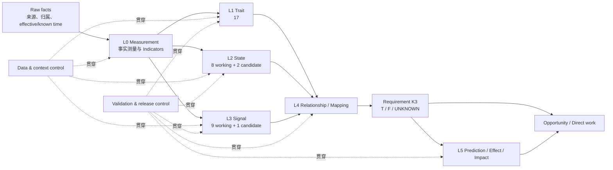
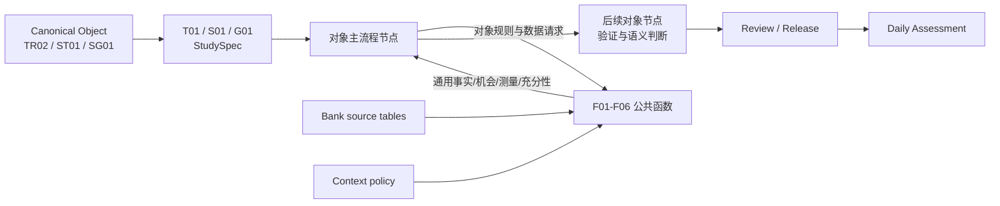
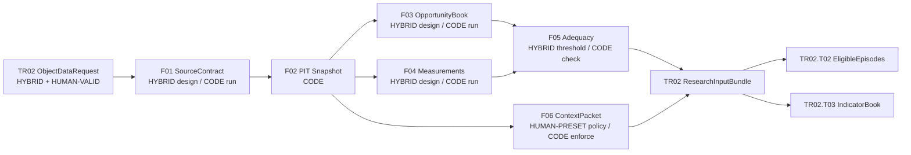
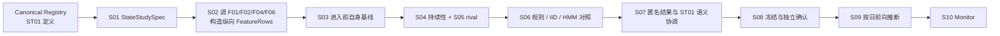
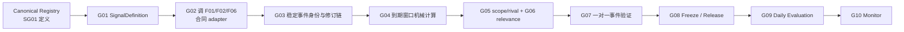
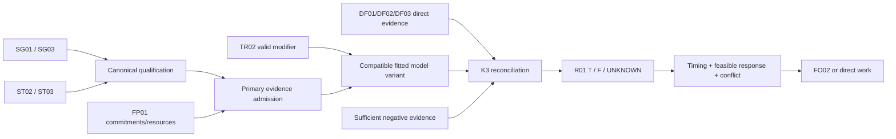
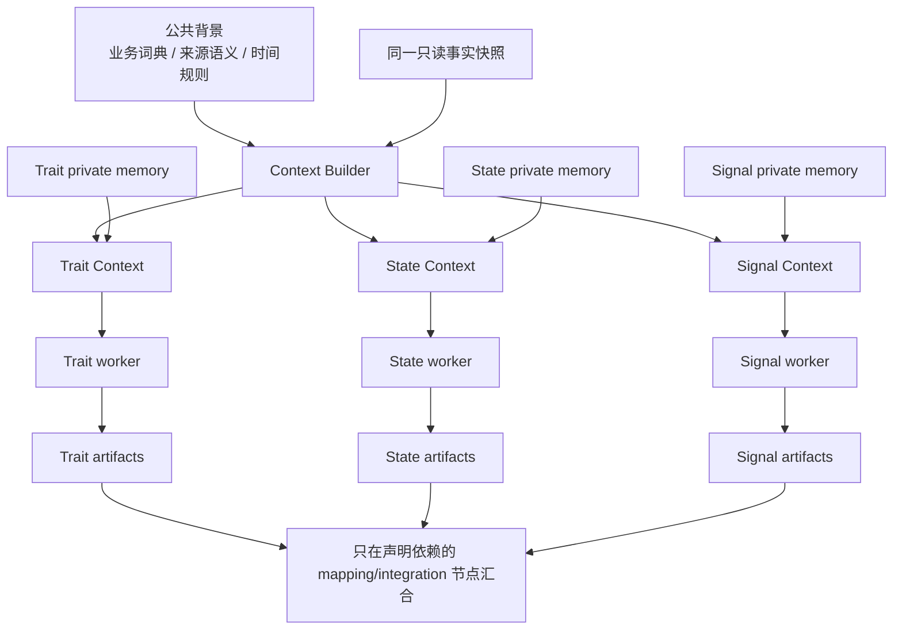
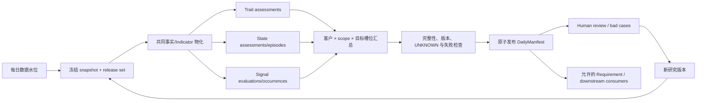

# EDF 4.0 Offline Research：六条研究线与三条完整示例

日期：2026-10-29  
依据：`edf-4.0` 当前维护设计、关系表和本地实现静态检查。本文中的“建议接口/节点”是目标架构；对象名称和关系来自 v4.0。未拟合、未确认或候选对象不会因为出现在图里而自动获得运行权限。

### 责任标注图例

- `HUMAN-PRESET`：由领域专家、研究负责人或治理委员会预先定义并版本化。
- `LLM-ASSIST`：LLM 可以起草、检索、归纳、生成候选方案或分析 bad case，但没有最终决定权。
- `HUMAN-VALID`：必须由人工检查证据、修改并签字批准；不能只依赖 LLM 自评。
- `HYBRID`：人工预设边界，LLM 在边界内辅助，人工再 validation；适合语义拆解、rival 归纳和案例评审。
- `CODE`：冻结后的确定性代码、统计程序或已批准模型执行；不允许 LLM 逐客户临时改规则。

**权威链路中没有 `LLM-only` 节点。**凡是对象语义、资格规则、验证结论和生产发布，都不能由 LLM 单独决定。

责任标注只说明“规则由谁设计、执行和批准”。示例中的日期、金额、比例等演示值只用于说明数据如何流转，不把它们标成“由 LLM 构造”。

## 1. 先回答：Offline Research 到底有几条线

如果只看图片中的“三个时钟”，你的理解是对的：核心对象生产有三条线：

1. Trait：慢时钟，研究长期稳定取向。
2. State：中时钟，研究一段时间持续存在的状态。
3. Signal：快时钟，研究事件、变化或临近里程碑。

如果看完整 Offline Research 系统，则应按六条研究产品线设计：

| 线 | 研究对象 | 主要产物 |
|---|---|---|
| L0 Indicator / Measurement | 原始事实怎样形成可靠、可复用的测量 | MeasurementDefinition、IndicatorValue、数据充足性报告 |
| L1 Trait | 是否存在持续的行为取向 | TraitAssessment、构念与稳定性证据 |
| L2 State | 某条件是否持续、何时进入和退出 | StateAssessment、StateEpisode |
| L3 Signal | 什么事件发生/临近，现在是否仍相关 | SignalOccurrence、SignalEvaluation、Relevance |
| L4 Relationship / Mapping | 哪个对象在什么条件下能支持哪个 Requirement | RelationshipDefinition、K3 Admission、mapping evidence |
| L5 Predictive / Effect / Decision Impact | 对接受度、响应、持续、uplift 或下游资源影响的研究 | ModelArtifact、校准、阈值、模拟对比 |

另外有两个贯穿全部线路的控制面，不作为单独业务对象线：

- Data & Context Control：时点、来源、权限、上下文隔离、数据划分。
- Validation & Release Control：对照、独立确认、人审、冻结、用途发布、日批监控、bad case。

图片中的数字是较早的 34 维基线：17 Traits + 8 States + 9 Signals。当前 v4.0 保留这 34 个工作对象，并新增三个候选扩展 ST09、ST10、SG10，因此研究目标槽位是 37 个；新增候选不等于已验证或已激活。



## 2. 公共节点与端到端节点到底是什么关系

### 2.1 它们不是上下两条流水线，而是“主流程调用公共函数”

最容易误解的画法是：

```text
F01 → F02 → F03 → F04 → F05 → F06 → T01 → T02 → ...
```

**实际不是这样。**真正拥有业务顺序的是对象端到端节点：Trait 用 `T01–T10`，State 用 `S01–S10`，Signal 用 `G01–G10`。`F01–F06` 更像一组公共函数库；某个 T/S/G 节点需要数据能力时才调用它，拿到返回值后继续自己的主流程。

```text
对象主流程节点 ──传入对象规则──> 公共 F 节点
对象主流程节点 <──返回事实/测量── 公共 F 节点
对象主流程节点 ──把通用返回值解释成该对象的证据──> 下一个对象节点
```

所以必须从对象开始：

```text
TR02 / ST01 / SG01 的 Canonical 定义
→ T01 / S01 / G01 编译该对象的 StudySpec
→ StudySpec 声明需要哪些来源、机会、测量、窗口、rival 和上下文
→ T/S/G 节点按需调用 F01–F06
→ 公共节点只返回通用的事实与测量，不替对象做语义结论
→ 对象节点完成研究、验证、发布和日常评估
```

可以把它理解为：

- `T/S/G 节点`是“项目经理和研究负责人”，决定为什么做、先做什么、证据怎样解释。
- `F 节点`是“共享实验室”，负责取数、时点安全、分母、公式、充分性和上下文隔离。
- 同一个 F 节点可以被多条线调用，但必须带上不同对象的 `StudySpec`，因此不会得到同一份无边界的大宽表。

### 2.2 一个对象节点到底怎样调用公共节点

| 主流程节点 | 它要解决的对象问题 | 调用的公共能力 | 公共返回值 | 主流程继续加工成 |
|---|---|---|---|---|
| TR02.T02 Opportunity | 什么才算一次真实自主的流动性选择？ | F01 来源绑定、F02 PIT 快照、F03 机会账本、F06 context policy | 通用 `OpportunityBook` | TR02 专属 `EligibleEpisodes` |
| TR02.T03 Indicator | 怎样测量长期流动性缓冲取向？ | F04 类型化测量、F05 充分性 | `MeasurementValue + AdequacyReport` | TR02 `IndicatorBook` |
| ST01.S02 Feature | 怎样构造不会偷看未来的流动性积累序列？ | F01、F02、F04、F06 | PIT 周度事实与测量 | ST01 `FeatureRows` |
| SG01.G02 Adapter | 哪些合同事实可以用于“到期临近”？ | F01、F02、F06 | 当时已知的合同事实 | SG01 `NormalizedContractFact` |

这里最重要的一对区别是：

- `F03 OpportunityBook`：通用层回答“这里有没有一次可观察机会”。
- `TR02.T02 EligibleEpisodes`：TR02 语义层回答“这次机会能不能作为 Liquidity Buffer Orientation 的证据”。

前者不会知道 TR02 的正反例、强制行为排除和 rival；后者不能自己绕开 PIT、安全分母和来源血缘。两者必须组合，不能互相替代。

### 2.3 控制流和数据流放在一起看



下面三个例子都严格按这个顺序模拟：**先选定 canonical object，再逐个走完它自己的十个端到端节点；客户级数据只在最后的日常运行节点出现。**

### 2.4 公共链 F01–F06：以 TR02 的一次调用完整模拟

公共链不是自己启动。这里假设 `TR02.T02/T03` 已经根据 `TraitStudySpec` 发出一个 `ObjectDataRequest`，要求研究“自主流动性选择机会”和三个候选指标家族。示例中的具体记录只用于解释接口和数据流，不单独标注其构造来源。

**本例必须由人工预设并版本化的公共规则：**

- 调用入口：TR02 的研究用途、最小字段范围、允许来源、禁止读取的对象结论、as_of 口径。
- F01：主体/账户/合同身份映射、权威来源、grain、币种与单位、effective_at/known_at 字段语义。
- F02：PIT 截止规则、去重优先级、迟到修订和 supersedes 政策。
- F03：什么叫一次 opportunity、stable ID、产品不可得/强制行为/来源缺失的 reason code。
- F04：stable cash share、buffer ratio、rollover persistence 的公式、方向、单位、窗口、零分母和缺失政策。
- F05：最少历史、distinct episode、独立方法家族、split 和独立参照的充分性门槛。
- F06：TR02 worker 的 allowlist/denylist；允许公共背景和原始事实，禁止读取 State/Signal 最终结论。
- 调用返回：bundle schema、版本/hash、异常处理和可消费范围；公共链不得直接输出 TR02 结论。

| 步骤 | 责任模式 | Input | 公共原子能力 | Output | TR02 调用例子 | LLM-ASSIST | HUMAN-VALID |
|---|---|---|---|---|---|---|---|
| 调用入口 | `HYBRID` | `TR02.TraitStudySpec`、调用节点、as_of、允许来源与字段 | 将对象需求编译为最小数据请求；禁止请求无边界“全客户画像” | `TR02.ObjectDataRequest` | 只请求余额/持仓、已知义务、定存到期与续存、产品可得性 | 起草 request、检查字段缺口 | 审核用途、最小化范围和授权 |
| F01 Source binding | `HYBRID` 设计 + `CODE` 执行 | `ObjectDataRequest`、source catalog、schema、owner | 绑定主体/账户/资金池、grain、币种、单位、权威来源、effective/known time | `SourceContract` | 将 core account、TD contract、product availability 映射到 TR02 typed facts | 建议字段映射、生成 schema diff | data owner 与研究负责人确认语义和权威来源 |
| F02 PIT snapshot | `HUMAN-PRESET` policy + `CODE` 执行 | `SourceContract`、原始记录、as_of、修订历史 | 去重；只保留当时已知记录；保留迟到与 supersedes 血缘 | `SnapshotManifest + TypedFacts` | `as_of=2026-10-01` 时，2026-10-05 才到达的修订不能进入该快照 | 解释异常日志、归纳修订模式；不裁决逐行时点 | 验证 PIT 规则、抽样回放和泄漏测试 |
| F03 Opportunity book | `HYBRID` 定义 + `CODE` 枚举 | PIT facts、通用 OpportunitySpec、产品/渠道可得性 | 构造“本来有机会被观察什么”的完整候选分母；标记不可观察原因 | `OpportunityBook` | 为每次到期/配置机会生成 stable `opportunity_id`；自动强制续存保留但标记 `FORCED` | 起草 OpportunitySpec、从 bad case 提议 reason code | 冻结机会定义、排除政策和分母语义 |
| F04 Measurement | `HYBRID` 设计 + `CODE` 计算 | TypedFacts、公式/AST、窗口、OpportunityBook | 类型/单位检查、公式编译、分子分母、coverage、missing reason、来源贡献 | `MeasurementValue / IndicatorValue` | 计算 stable cash share、buffer ratio、rollover persistence；零分母返回 `UNAVAILABLE` | 提出候选公式、生成测试用例、解释失败 | 批准公式、单位、方向和测试结果 |
| F05 Adequacy | `HUMAN-PRESET` 门槛 + `CODE` 检查 | Measurements、研究协议、split manifest、独立参照清单 | 检查历史、覆盖、distinct episodes、方法家族、标签/参照和分区是否足够 | `AdequacyReport` | 只有一个方法家族或 CERT 无独立参照时返回 `INSUFFICIENT/DEFER` | 归纳缺口、生成 review 摘要 | 预注册门槛并审核 defer/override；LLM 不得放宽门槛 |
| F06 Context packet | `HUMAN-PRESET` policy + `CODE` 强制 | 对象 ID、worker role、context policy、typed facts、background source | 按 allowlist/denylist 生成最小上下文；记录看过什么、没看什么和版本 | `ContextManifest + ContextPacket` | TR02 worker 可读取公共背景与原始事实，但不能看到 State/Signal 最终结论 | 只能消费 packet 内授权内容，不能自行扩权 | 安全/研究 owner 批准 policy 并审计越权测试 |
| 调用返回 | `CODE` 组装 + `HYBRID` 异常评审 | F01–F06 outputs、request ID、版本与 hash | 封装为对象可消费但仍无对象结论的 bundle | `TR02.ResearchInputBundle` | T02 用 OpportunityBook 产生 `EligibleEpisodes`；T03 用 MeasurementValue 产生 `IndicatorBook` | 总结 bundle、聚类异常 reason code | 审核异常和可用范围；对象结论仍由后续节点决定 |

完整数据流是：



公共链最重要的责任边界是：**LLM 可以帮助设计 contract 和解释异常，但 F02/F04/F05/F06 的逐记录执行必须是可测试、可回放的代码；公共链也永远不输出“TR02=TRUE”这样的对象结论。**

## 3. Trait 线：从 TR02 定义出发模拟完整链路

v4.0 中的精确 canonical 名称是 **TR02 — Liquidity Buffer Orientation**。可以口语化理解为 Liquidity Preference，但工程中的 ID、定义、版本和输出都应使用 canonical 名称，避免把“偏好流动性”误解成“今天现金很多”。

### 3.1 研究命题

不是“客户今天现金很多吗”，而是：

> 在存在真实自主选择机会、控制临时用途和可得性后，该客户是否持续倾向保留流动性缓冲；在冻结的可比人群中处于什么相对位置？

### 3.2 端到端节点

| 节点 | Input | 原子能力 | Output |
|---|---|---|---|
| T01 Target & definition | TR02 定义、适用人群、用途 | 固定正例、反例、UNKNOWN、禁止解释 | TraitStudySpec |
| T02 Opportunity construction | 自主现金/配置选择、可用产品、完整观察 | 找出真正可选择且可观察的 episodes | EligibleEpisodes |
| T03 Indicator calculation | 稳定现金占比、buffer ratio、续存行为等 | 按口径计算；分母为零返回 unavailable | IndicatorBook |
| T04 Attribution & rivals | 待付大额款、营运资金、近期到期、服务限制 | 区分长期取向与临时条件/外部限制 | RivalReport |
| T05 Family scorecard | 方向统一指标、来源/方法家族 | 家族内合成；家族间等权初始 comparator；不补 0 | RawTraitScore |
| T06 Frozen percentile | FIT 比较域、raw score | 用冻结 mid-CDF 将 raw score 转为相对百分位 | TraitPercentile |
| T07 Persistence | 前/后半窗口、episode 数、覆盖 | 检查至少两个独立方法家族、时间跨度和分半漂移 | StabilityReport |
| T08 Construct validation | 独立取向参照、相关/无关构念、分群 | 收敛、区分、时间和人群稳定性检验 | TraitValidation |
| T09 Review & release | 定义、测量、验证、用途 | retain/reject/defer；冻结精确版本和 permitted use | TraitReleaseBundle |
| T10 Daily assessment | 当日快照、冻结包、有效旧证据 | 只在依赖变化/到期时刷新；保留原 as_of | TraitAssessment |

```mermaid
flowchart LR
  A[Canonical Registry<br/>TR02 定义] --> B[T01 TraitStudySpec]
  B --> C[调用 F01-F06<br/>构造 TR02 专属研究输入]
  C --> D[T02 EligibleEpisodes]
  D --> E[T03 IndicatorBook]
  E --> F[T04 RivalReport]
  F --> G[T05 RawTraitScore]
  G --> H[T06 FIT Percentile]
  H --> I[T07 StabilityReport]
  I --> J[T08 TraitValidation]
  J --> K[T09 Release / Defer / Reject]
  K --> L[T10 Daily TraitAssessment]
```



### 3.3 从 TR02 出发，把 T01–T10 完整模拟一遍

这条例子分成两段：`T01–T09` 是**对象研究与发布链**，研究单位是 cohort、episode 和独立分区；`T10` 才是**已发布对象的客户级日常计算**。这样就不会把“某客户 180 天内有什么”误当成 TR02 的定义。

当前 canonical 文件把核心 Traits 标为 `D1 / V0 / ACTIVE_WORKING`。下面是在演示 contract 怎样传递，不代表仓库已经产生 TR02 的 CERT/FINAL 验证结论。

**TR02 本例的人工预设清单：**

| 节点 | 必须在看最终结果前由人工预设并版本化的内容 |
|---|---|
| T01 | TR02 的 canonical 含义；正例、反例、UNKNOWN；适用主体；禁止解释；允许用途；候选指标家族与 rivals |
| T02 | 自主选择的定义；eligible 分母；产品不可得、强制续存、归属不清和结果缺失的排除/reason code |
| T03 | stable cash share、buffer ratio、rollover persistence 的公式语义、方向、单位、窗口、零分母政策 |
| T04 | pending purchase、working capital、recent maturity、uncertainty、服务限制等 rival taxonomy；explained/unknown/defer 政策 |
| T05 | 允许比较的聚合方案、家族边界、缺失家族不补 0、模型选择指标；具体拟合结果不是人工预设 |
| T06 | comparable population domain、只在 FIT 拟合、mid-CDF 方法、冻结和版本政策 |
| T07 | P03 候选窗口/episode/drift 网格、split-half 设计、最低方法家族和证据跨度、通过门槛 |
| T08 | 独立参照、相关/无关构念、group/time split、收敛/区分/稳定性指标和成功门槛 |
| T09 | retain/defer/reject/redefine gate、必需 evidence、permitted use、审批人和回滚规则 |
| T10 | refresh 条件、过期、PIT、supersedes、解释输出和 QA/申诉政策；不得运行时改变 T01–T09 |

#### T01 — 从 Registry 取出 TR02，编译研究对象

**责任标注：**`HYBRID`。`HUMAN-PRESET` 定义 canonical 含义、正反例、UNKNOWN、禁用解释和允许用途；`LLM-ASSIST` 可把专家语言拆成候选 StudySpec、补充反例/rival；`HUMAN-VALID` 必须逐项审核并批准版本。LLM 不能创建正式 TR02 定义。

**Input** 是对象定义，不是客户数据：

```yaml
object_id: TR02
canonical_name: Liquidity Buffer Orientation
plain_alias: Liquidity Preference
research_question: 在真实自主选择机会下，是否持续倾向保留流动性缓冲？
candidate_indicator_families:
  - stable_cash_share
  - liquidity_buffer_ratio
  - deposit_rollover_persistence
main_rivals:
  - pending_purchase
  - working_capital
  - recent_maturity
  - uncertainty
prohibited_interpretations:
  - current_cash_level_is_the_trait
  - trait_percentile_is_purchase_probability
```

T01 把 seed 编译成 `TraitStudySpec`，明确正证据、反证据、UNKNOWN、适用主体、独立参照、禁止用途和允许用途。P03 的窗口、最少 episode、最大 drift 是待研究参数网格，而不是先替某个客户选择 `180d`。

**Output：**`TR02.TraitStudySpec.v1`。

#### T02 — 根据 TR02 的语义，先定义“什么算证据机会”

**责任标注：**`HYBRID` 设计，`CODE` 执行。`HUMAN-PRESET` 决定自主选择、有效分母和排除原则；`LLM-ASSIST` 可从业务说明/bad case 起草 eligibility 条件与 reason code；`HUMAN-VALID` 必须用标注样本审查边界案例。冻结后逐条 eligibility 由代码判断，不由 LLM 临场决定。

T02 读取 `TraitStudySpec`，先写出 `EligibilitySpec`：一次定存到期后的自主配置、一次存在可选产品的资金配置决定，可以成为候选 episode；强制续存、产品不可得、主体归属不清、结果缺失不能成为有效分母。

然后 T02 才调用 F01/F02/F03/F06：F 节点在研究总体上绑定来源、生成 PIT 快照和通用 `OpportunityBook`；T02 再按 TR02 规则筛出 `EligibleEpisodeSet`。这里的输出是一组带 `subject_id + episode_id + eligibility_reason + as_of` 的研究记录，不是某一个客户的 Trait 分数。

**Output：**`TR02.EligibleEpisodeSet`，并保留所有排除项的 reason code。

#### T03 — 为 TR02 编译候选指标，而不是直接训练“Trait 概率”

**责任标注：**`HYBRID` 设计，`CODE` 计算。`HUMAN-PRESET` 确定候选指标家族、公式语义、单位和方向；`LLM-ASSIST` 可提出公式草案、字段映射和测试用例；`HUMAN-VALID` 审核业务含义、零分母、数据血缘和单元测试。生产数值只能由冻结代码生成。

T03 从 `TraitStudySpec` 取出三个候选家族，并调用 F04/F05 生成带血缘的测量：

- balance structure：stable cash share、liquidity-buffer ratio；
- maturity decision：deposit rollover persistence；
- 每个值都保存分子、分母、单位、窗口、来源贡献和 missing reason；
- 零分母返回 `UNAVAILABLE`，不能填成 0。

**Output：**`TR02.IndicatorBook`。每个 row 仍只是候选测量，不是 canonical Trait 结论。

#### T04 — 用 TR02 预注册的 rivals 做归因检查

**责任标注：**`HYBRID`。`HUMAN-PRESET` 冻结必须检查的 rival taxonomy 和处置规则；`LLM-ASSIST` 可从研究文献、专家材料和 bad case 归纳候选竞争解释、生成案例摘要；`HUMAN-VALID` 判断 rival 是否完整、是否有可用证据以及 UNKNOWN/defer 是否合理。结构化条件冻结后由代码执行。

T04 不等到看到结果后再找解释，而是按 T01 冻结的 rival 列表构造测试：pending purchase、working capital、recent maturity、uncertainty、产品可得性和服务模式是否足以解释候选指标。

例如：如果高现金完全来自已知的大额首付款准备，记录应输出 `EXPLAINED_BY_PENDING_PURCHASE`；如果无法获得必要 rival 数据，输出 UNKNOWN/defer；只有尚未被竞争解释吸收的部分才进入后续 Trait comparator。

**Output：**`TR02.RivalReport`，逐条记录 explained、unresolved 和 unknown。

#### T05 — 在研究总体内形成透明 RawTraitScore

**责任标注：**`HUMAN-PRESET` 方法菜单 + `CODE` 拟合/计算。`LLM-ASSIST` 可生成候选聚合方案说明和结果对比摘要，但不能看结果后随意发明权重；`HUMAN-VALID` 审核预注册方案、缺失处理、稳定性和选择证据。

T05 先把各指标方向统一，再家族内合成、家族间等权；缺失家族不补 0。它会在 FIT 数据上比较若干预注册聚合方案，而不是让 agent 临时发明权重。

```text
balance_structure_family = aggregate(stable_cash_share, buffer_ratio)
maturity_decision_family = aggregate(rollover_persistence)
raw_trait_score = equal_weight(available_independent_families)
```

**Output：**`TR02.RawTraitScoreSet + AggregationSpec`。这是研究 comparator，不是“拥有 TR02 的概率”。

#### T06 — 在 FIT 比较域冻结 percentile transform

**责任标注：**`HUMAN-PRESET` 比较域/方法 + `CODE` 拟合与变换。`LLM-ASSIST` 可解释 transform、检查文档一致性；`HUMAN-VALID` 审核 comparable domain、PIT/split 安全和冻结版本。逐客户 percentile 不由 LLM估算。

T06 先定义 comparable opportunity domain，例如主体类型、数据覆盖和产品可得性必须可比；随后只用 FIT 分区拟合 mid-CDF transform，并把 transform 版本冻结。TUNE/CERT/FINAL 只能调用这个 transform，不能重新看全量人群调百分位。

**Output：**`TR02.PercentileTransform + TraitPercentileSet`。`0.81` 只能读成“在冻结比较域中处于第 81 百分位附近”，不能读成 81% 的购买概率或 81% 的人格确定性。

#### T07 — 检查 TR02 是否真的像一个慢时钟 Trait

**责任标注：**`HUMAN-PRESET` 候选网格/门槛 + `CODE` 检验。`LLM-ASSIST` 可归纳失败模式和生成 review 摘要；`HUMAN-VALID` 审核窗口选择、分半设计、漂移门槛和例外处置，防止为了通过而事后改标准。

T07 按 P03 网格检查：独立方法家族数量是否足够、证据跨度是否足够、前后非重叠窗口的 percentile drift 是否在阈值内、不同时间段是否保持方向。窗口 `{90,180,365}` 是候选研究设计；由 FIT/TUNE 比较后冻结，不是例子的起点。

**Output：**每个候选 tuple 的 `TR02.StabilityReport`，包含 pass/fail/unknown 与失败原因。

#### T08 — 用独立参照验证“这个构念确实是 TR02”

**责任标注：**`HYBRID` 研究评审。统计检验由 `CODE` 执行；`LLM-ASSIST` 可整理收敛/区分证据、检查报告缺口和汇总 bad case；`HUMAN-VALID` 必须解释结果、判断构念是否成立并签字。LLM 不能把相关性自行宣布为 validated Trait。

T08 在 group/chronological 独立分区上检查：与独立 elicited liquidity-orientation reference 是否收敛；与无关构念是否区分；控制财富、服务层级、产品可得性和临时 State 后是否仍成立；不同人群和时间是否稳定。

这一步验证的是对象构念，不是挑一个看起来分数高的客户。没有真实执行产物时，正确输出是：

```yaml
object_id: TR02
validation_status: NOT_YET_DEMONSTRATED
reason: no frozen CERT/FINAL evidence attached
```

**Output：**`TR02.TraitValidation`。

#### T09 — 决定 TR02 是 retain、defer、reject 还是 redefine

**责任标注：**`HUMAN-VALID` 最终决策。`LLM-ASSIST` 只能生成 evidence pack 摘要、列出未解决风险和建议动作；治理委员会/研究 owner 决定 retain、defer、reject 或 redefine，并批准 permitted use。冻结与签名由 `CODE` 记录。

只有 T08 达到预声明门槛，T09 才能冻结 `definition_version + indicator versions + eligibility version + P03 tuple + FIT transform + population domain + permitted_use`。数据或参照不足则 defer；被临时条件稳定解释则 reject/redefine。

按仓库当前 `D1/V0/ACTIVE_WORKING` 状态，这次模拟应停在 `RESEARCH_ONLY / DEFER_PRODUCTION`，不能把 TR02 冒充生产级已验证特征。

**Output：**`TR02.TraitReleaseDecision`；通过时才另有 `TraitReleaseBundle`。

#### T10 — 只有发布以后，才给具体客户做日常评估

**责任标注：**`CODE` 主责。人工已在 T09 预设并批准 release；LLM 不参与逐客户打分、改窗口或改权重。`LLM-ASSIST` 仅可在结果生成后依据 trace 形成可读解释；`HUMAN-VALID` 通过抽样 QA、申诉和 bad-case review 监督运行质量。

假设未来 TR02 已通过验证并发布，T10 才会把冻结包应用到某个客户的 PIT 输入。此时可以出现一个说明性的客户级结果：

```yaml
object_id: TR02
subject_id: C001
as_of: 2026-10-28
raw_score: 0.792
percentile: 0.81
source_family_count: 2
coverage_status: SUFFICIENT
stability_status: PASS
trait_probability: null
release_id: hypothetical-validated-release
```

这里的重点不是 180 天，而是 T10 **只能执行 T09 已冻结的设计**。如果迟到事实改变历史输入，产生新的 assessment 和 `supersedes` 链，不能覆盖旧结论。

## 4. State 线：以 ST01 流动性积累为完整例子

### 4.1 研究命题

> 客户当前是否处于相对于自身正常使用和已知计划流量的持续异常流动性积累状态？何时进入、持续多久、何时退出？

### 4.2 端到端节点

| 节点 | Input | 原子能力 | Output |
|---|---|---|---|
| S01 Target & candidate | ST01 含义、方向、窗口候选、rivals | 固定状态命题和 episode 语义 | StateStudySpec |
| S02 Longitudinal feature | 周度可用流动资源、计划流量、来源完整性 | 计算实际斜率、正常基线斜率、异常超额 | FeatureRows |
| S03 Entry baseline | episode 前完整 W 周 | 建立客户自身基线；进入后保持锚点 | BaselineArtifact |
| S04 Persistence | 连续完整观察、P04 候选网格 | 检查进入支持比例、最短持续、退出 hysteresis | PersistenceEvidence |
| S05 Rival controls | 工资、季节、市场、计划流量、源修订 | 解释可解释部分；未解决部分保留 | RivalReport |
| S06 Model comparison | 规则、IID/HMM/空模型 challenger | 比较持续性、转移、似然、可解释性 | StateModelEvidence |
| S07 Semantic reconciliation | 匿名 component、ST01 独立参照 | 判断 component 是否真能命名 ST01 | ReconciliationDecision |
| S08 Freeze & confirm | 选定模型/规则、feature、split | 冻结并在未使用数据确认 | StateReleaseBundle |
| S09 Daily inference | 当日 feature、上次 assessment、episode anchor | 按时间向前更新，判断进入/保持/退出/OOD/UNKNOWN | StateAssessment + StateEpisode |
| S10 Monitor | 占用率、持续期、转移、缺测、迟到标签 | 发现漂移、异常持续、版本问题 | StateMonitorFinding |



### 4.3 从 ST01 出发，把 S01–S10 完整模拟一遍

ST01 的 canonical 名称是 **Liquidity Accumulation**。`S01–S08` 先研究“什么样的时间过程才有资格被命名为 ST01”，`S09` 才把冻结规则应用到客户时间序列，`S10` 监控上线后的表现。

**ST01 本例的人工预设清单：**

| 节点 | 必须在看最终结果前由人工预设并版本化的内容 |
|---|---|
| S01 | ST01 的状态语义、时间尺度、方向、进入/保持/退出/UNKNOWN、主要 rivals 和允许用途 |
| S02 | 可用流动资源、计划流量、实际/基线斜率、覆盖字段；周粒度；PIT 前缀安全和上下文隔离 |
| S03 | 候选 baseline 家族、lookback 网格、进入前 anchor、进入后不滚动、防泄漏规则 |
| S04 | P04 的 K/M 网格、最短持续期、允许短缺测、保持与退出 hysteresis、通过门槛 |
| S05 | 工资、季节、证券出售、内部转账、计划税款/购置、市场估值、修订的 rival taxonomy 和 UNKNOWN 政策 |
| S06 | 规则/IID/HMM/空模型菜单、共同 split、比较指标、复杂模型保留条件 |
| S07 | 独立 ST01 参照、component 命名证据、冲突条件、defer/reject 政策 |
| S08 | freeze 内容、confirmation split、episode/coverage/分群门槛、permitted use 和审批 gate |
| S09 | 前向推断、进入/保持/退出/OOD/UNKNOWN、episode anchor、缺测与 supersedes 规则 |
| S10 | 占用率、持续期、转移、UNKNOWN、迟到修订、分群和 bad-case 告警门槛及处置流程 |

#### S01 — 从 Registry 编译 ST01 StateStudySpec

**责任标注：**`HYBRID`。`HUMAN-PRESET` 确定 ST01 的业务含义、时间尺度、进入/保持/退出/UNKNOWN 和 rivals；`LLM-ASSIST` 可拆解语义、提出候选 feature/persistence 问题；`HUMAN-VALID` 审核并批准 StateStudySpec。

**Input：**`ST01 = Sustained abnormal build-up of liquid assets relative to client/context baseline`。

S01 把这句话拆成必须验证的语义：对象是“当前状态”而不是长期 Trait；方向是 liquid assets build-up；参照是客户自身/上下文 baseline；必须 sustained；需要进入、保持、退出和 UNKNOWN 语义；主要 rivals 包括工资、季节性、内部转账、市场变化、已知计划流量和来源修订。

**Output：**`ST01.StateStudySpec`，包含候选 feature、P04 persistence 网格、rival 列表和独立参照设计。

#### S02 — 由 ST01 反推纵向 FeatureRows

**责任标注：**`HYBRID` 设计，`CODE` 物化。`HUMAN-PRESET` 定义所需事实、时间粒度和前缀安全要求；`LLM-ASSIST` 可起草字段映射、feature DAG 和测试；`HUMAN-VALID` 检查来源、时点泄漏、单位和覆盖。逐行 feature 由代码生成。

S02 根据 StudySpec 调用 F01/F02/F04/F06，而不是先把全量客户宽表交给 State agent。公共层返回 PIT 安全的余额、持仓、计划流量和覆盖事实；S02 将它们加工成 ST01 专属周度 row：

```text
available_liquid_resources
expected_baseline_flow
known_planned_flow
actual_slope
source_coverage
as_of / known_at
```

任何时点只能使用当时已知的前缀数据，不能用 episode 结束后的信息回填进入判断。

**Output：**`ST01.FeatureRows`。

#### S03 — 定义并冻结“进入前基线”

**责任标注：**`HUMAN-PRESET` 候选 baseline + `CODE` 估计。`LLM-ASSIST` 可提出候选方案和检查基线漂移案例；`HUMAN-VALID` 审核 lookback、anchor、防泄漏和不同群体适用性。运行时 baseline 不能由 LLM 重写。

S03 比较若干预注册 baseline 方案，例如进入前完整 W 周的 robust level/slope 或上下文调整后的正常轨迹。基线必须在进入判定前形成；一旦 episode 进入，anchor 不能每周跟着余额滚动，否则会把持续积累状态自己消掉。

**Output：**`ST01.BaselineArtifact`，带 `baseline_as_of、lookback、feature_version、coverage`。

#### S04 — 研究 sustained 应该怎样定义

**责任标注：**`HUMAN-PRESET` P04 网格/门槛 + `CODE` 比较。`LLM-ASSIST` 可归纳持续期 bad case、提出待比较 K/M 组合；`HUMAN-VALID` 冻结进入、保持、缺测和退出 hysteresis 规则。

S04 使用 P04 候选网格比较进入支持比例、最短持续期、允许的短缺测和退出 hysteresis。例如研究候选可以是“连续 K 个完整周中至少 M 个支持异常正超额”；具体 K/M 必须在 FIT/TUNE 选择并冻结，不应由运行时 agent 自由解释。

**Output：**每个候选设计的 `ST01.PersistenceEvidence`。

#### S05 — 排除或保留竞争解释

**责任标注：**`HYBRID`。`HUMAN-PRESET` 定义 rival taxonomy、证据优先级和 UNKNOWN 政策；`LLM-ASSIST` 可从 episode trace/文本材料归纳候选解释并生成 review 摘要；`HUMAN-VALID` 审核归因充分性。结构化扣除和 reason code 由代码执行。

S05 对每个候选 episode 检查工资、季节、证券出售、内部转账、计划税款/购置、市场估值和迟到修订。可以解释的部分从异常超额中扣除；关键 rival 缺失则 UNKNOWN；剩余未解释且持续的正超额才支持 ST01。

**Output：**`ST01.RivalReport`，不是简单的 true/false 掩码，而是逐来源的 attribution trace。

#### S06 — 比较规则、IID、HMM 和空模型

**责任标注：**`HUMAN-PRESET` 模型菜单/指标 + `CODE` 训练评估。`LLM-ASSIST` 可生成实验配置草案、汇总模型差异和异常 episode；`HUMAN-VALID` 判断复杂模型是否带来可信改善，不能让 LLM 按单一分数自动选 HMM。

S06 在相同 feature opportunity 和 split 上比较透明规则、IID mixture/HMM challenger 与常规空模型，检查 likelihood、持续性、转移合理性、episode 碎片化和可解释性。更复杂模型只有在独立证据改善时才有资格保留。

**Output：**`ST01.StateModelEvidence`。此时 HMM component 仍是匿名的，例如 `component_2`，还不能直接叫 ST01。

#### S07 — 把匿名统计 component 与 ST01 语义协调

**责任标注：**`HYBRID`，且 `HUMAN-VALID` 是最终关口。`LLM-ASSIST` 可比较 component profile 与 ST01 定义、聚类案例和列出冲突证据；领域专家必须决定是否允许命名、defer 或 reject。这个语义映射不能由 LLM-only 完成。

S07 使用独立 ST01 参照、方向、rival 残差、持续期和 episode 样例判断：`component_2` 是否真的代表“持续异常流动性积累”，还是工资周期、来源缺测或另一个 State。如果无法唯一协调，应输出 defer/unknown，不得仅凭“均值最高”命名。

**Output：**`ST01.ReconciliationDecision`。

#### S08 — 冻结模型并在未使用分区确认

**责任标注：**`CODE` 执行确认，`HUMAN-VALID` 批准发布。`LLM-ASSIST` 可检查 evidence pack 完整性和生成分群/bad-case 摘要；人工审核未使用分区结果、风险和 permitted use，并决定 release/defer。

S08 冻结 feature 版本、baseline、persistence、rival policy、模型、语义映射、进入/退出策略和 permitted use，然后在未参与选择的 chronological/group partition 上确认 episode 指标、coverage 和 adverse subgroup behavior。

按当前 `D1/V0/ACTIVE_WORKING` 状态，如果没有对应确认产物，应输出 `NOT_YET_DEMONSTRATED / DEFER_PRODUCTION`。

**Output：**`ST01.StateReleaseDecision`；通过后才产生 `StateReleaseBundle`。

#### S09 — 发布以后才运行具体客户 episode

**责任标注：**`CODE` 主责。冻结 release 机械执行前向推断；LLM 不得逐客户决定进入/退出或补写缺失证据。`LLM-ASSIST` 仅能把已生成 trace 转成说明；`HUMAN-VALID` 通过抽样 QA、申诉和 episode review 监督结果。

假设未来 ST01 release 已批准，现在才出现客户 C001：进入前冻结基线稳定，之后连续三个完整周的异常超额斜率为正，且 S05 的已知 rivals 不足以解释。S09 使用冻结的进入政策建立：

```yaml
object_id: ST01
subject_id: C001
episode_id: ST01:C001:2026-10-12
assessment: TRUE
phase: ENTERED
baseline_anchor: pre-entry-frozen
evidence_status: SUFFICIENT
```

下一周即使余额继续上升，也不重滚基线；某周缺失则输出 UNKNOWN/INSUFFICIENT，不自动退出；满足冻结退出规则后才关闭 episode。命名 States 可以多标签并存，ST01–ST10 的概率不要求相加等于 1。

#### S10 — 监控 ST01 是否在生产中失真

**责任标注：**`HYBRID` 监控。`CODE` 计算占用率、持续期、转移和漂移；`LLM-ASSIST` 聚类 bad case、总结共同模式、生成 ReviewTask 草稿；`HUMAN-VALID` 判断问题来源和是否触发重研/暂停。LLM 不能直接在线改阈值。

S10 按版本监控占用率、episode 持续期、进入/退出转移、UNKNOWN、迟到修订、群组差异和 bad case。若大量 episode 被事后证明只是工资周期或内部转账，生成带来源、版本和复现输入的 `StateMonitorFinding`，回流 S01/S05/S08，而不是直接在线改阈值。

**Output：**`ST01.StateMonitorFinding + ReviewTask`。

## 5. Signal 线：以 SG01 定存到期临近为完整例子

### 5.1 研究命题

> 在评估时点，客户当前拥有、有效且可归属的定存合同是否进入冻结的到期窗口？事件事实、今天的评估和下游相关性分别是什么？

### 5.2 端到端节点

| 节点 | Input | 原子能力 | Output |
|---|---|---|---|
| G01 Event definition | SG01、窗口政策、合同状态规则 | 固定事件、里程碑与 FALSE/UNKNOWN 条件 | SignalDefinition |
| G02 Contract adapter | TD 合同、owner、due_at、status、版本 | 归属、状态、时间、修订与来源检查 | NormalizedContractFact |
| G03 Deduplication | 合同稳定 ID、版本、历史 occurrence | 同一合同/里程碑只建一个 occurrence；修订建立 supersedes | SignalOccurrence |
| G04 Deterministic evaluation | due_at、as_of、冻结 window | 计算 `0 <= due_at-as_of <= window` | SignalEvaluation T/F/U |
| G05 Scope & rival | 归属冲突、合同失效、日期冲突、来源缺失 | 阻止无效合同或未来才知道的数据进入 | EvidenceStatus / reason codes |
| G06 Relevance | occurrence、当前窗口、独立条件/请求 | 区分“历史事实”与“当前对某用途相关” | SignalRelevance |
| G07 Validation | 独立合同记录、事件一对一匹配 | 误报、漏报、延迟、重复、修订测试 | SignalValidation |
| G08 Release | 定义、适配器、窗口、验证、用途 | 冻结 detector 与消费者范围 | SignalReleaseBundle |
| G09 Daily evaluation | 当日 snapshot、release、历史 occurrence | 每天更新 T/F/U 与 relevance，不复制事件 | Daily SignalEvaluation |
| G10 Monitor | 重复率、来源延迟、UNKNOWN、过期/修订 | 发现数据与生命周期问题 | SignalMonitorFinding |



### 5.3 从 SG01 出发，把 G01–G10 完整模拟一遍

SG01 的 canonical 名称是 **TD Maturity Approaching**。`G01–G08` 先定义、验证并发布 detector，`G09` 才对具体合同进行每日评估，`G10` 监控事件质量。

**SG01 本例的人工预设清单：**

| 节点 | 必须在看最终结果前由人工预设并版本化的内容 |
|---|---|
| G01 | “有效且可归属的 TD 合同进入到期窗口”的事件语义；候选窗口；T/F/UNKNOWN；不是到账/意愿/Opportunity；允许用途 |
| G02 | 权威合同来源、stable contract ID、owner/status/due_at/effective_at/known_at、状态映射、时区和来源优先级 |
| G03 | occurrence key、同一事件判定、due_at 修订、canonical_due_version、supersedes 和去重政策 |
| G04 | 候选/冻结窗口、日历口径、边界是否包含、有效状态前提、FALSE/UNKNOWN 条件 |
| G05 | owner/status/source/date 冲突政策、来源权威、取消/过期未结清的处置和 reason code |
| G06 | occurrence/evaluation/relevance 的对象边界、consumer allowlist、relevance 条件和禁止推导 |
| G07 | 独立合同参照、一对一匹配政策、误报/漏报/延迟/重复/修订指标、time placebo 和门槛 |
| G08 | definition/adapter/key/window/source/consumer 的冻结内容、research/production gate 和 permitted use |
| G09 | daily as_of、PIT、T/F/U、连续 TRUE 不复制 occurrence、解释和 supersedes 政策 |
| G10 | 重复率、来源延迟、UNKNOWN、due_at 修订、漏报、过期 occurrence、越权消费的告警和暂停规则 |

#### G01 — 从 Registry 编译 SignalDefinition

**责任标注：**`HYBRID`。`HUMAN-PRESET` 定义事件语义、scope、T/F/UNKNOWN、候选窗口和 permitted use；`LLM-ASSIST` 可拆解业务描述、提出边界案例和候选状态映射；`HUMAN-VALID` 审核并批准 SignalDefinition。

**Input：**`SG01 = TD Maturity Approaching`，而不是先输入 TD1。

G01 先固定业务语义：对象是“有效且可归属的定存合同进入冻结到期窗口”；它不是资金已经到账、不是客户有投资意愿、不是 Opportunity。研究候选包括窗口长度、日历口径、有效合同状态、FALSE/UNKNOWN 条件和允许消费者。

**Output：**`SG01.SignalDefinition`。

#### G02 — 由 SG01 定义反推合同 adapter

**责任标注：**`HYBRID` 设计，`CODE` 执行。`HUMAN-PRESET` 确定权威来源、最小字段、状态语义和时区；`LLM-ASSIST` 可建议 schema mapping、发现字段冲突、生成 adapter 测试；`HUMAN-VALID` 由 data owner/研究负责人确认映射和来源优先级。

G02 根据 SignalDefinition 调用 F01/F02/F06，要求最小必要字段：stable contract ID、subject owner、status、due_at、effective_at、known_at、source version。adapter 统一不同核心系统的状态和时区，但不能猜测缺失到期日，也不能把未来才到达的修订放回过去。

**Output：**`SG01.NormalizedContractFactSet`。

#### G03 — 定义“一个事件到底是什么”，防止每天复制

**责任标注：**`HUMAN-PRESET` 事件身份规则 + `CODE` 去重。`LLM-ASSIST` 可从重复/修订 bad case 提议 occurrence key 和 reason code；`HUMAN-VALID` 必须审核同一事件、修订事件和 supersedes 的业务语义。

G03 冻结 occurrence key，例如：

```text
occurrence_key = subject_id + contract_id + milestone_type + canonical_due_version
```

同一合同进入 14 日窗口后连续十天为 TRUE，仍是一个 occurrence 的十次 evaluation；合同到期日被正式修订时，新 occurrence/evaluation 通过 `supersedes` 指向旧版本，而不是无痕覆盖。

**Output：**`SG01.SignalOccurrence` 与事件身份规则。

#### G04 — 编译确定性到期窗口规则

**责任标注：**`HUMAN-PRESET` 候选规则/窗口 + `CODE` 编译和判断。`LLM-ASSIST` 可生成规则草案、边界测试和自然语言解释；`HUMAN-VALID` 审核日历口径、边界包含关系、UNKNOWN 条件和窗口选择。每日 T/F/U 不由 LLM判断。

G04 把候选窗口编译为可复现规则：

```text
TRUE     when valid_contract and 0 <= due_at - as_of <= frozen_window
FALSE    when valid_contract and due_at - as_of > frozen_window
UNKNOWN  when owner/status/due_at/PIT evidence is insufficient or conflicting
```

窗口需要通过研究/政策选择后冻结，不能由 daily agent 按客户情况修改。

**Output：**`SG01.DetectorPlan`，可对合同事实产生 T/F/UNKNOWN。

#### G05 — 检查 scope 和竞争解释

**责任标注：**`HYBRID` 设计，`CODE` 执行。`HUMAN-PRESET` 定义 owner/status/source 冲突的处置政策；`LLM-ASSIST` 可归纳新冲突模式和解释日志；`HUMAN-VALID` 审核异常样本、来源权威和 UNKNOWN 政策。

G05 验证合同是否属于目标客户、状态是否有效、到期日是否冲突、来源是否权威、该条资料在 as_of 是否已知。已取消合同不得产生 TRUE；两个权威来源日期冲突时应 UNKNOWN；过期但未结清属于另一个生命周期问题，不能硬塞进“Approaching”。

**Output：**`SG01.EvidenceStatus + reason_codes`。

#### G06 — 把 occurrence、daily evaluation、relevance 分开

**责任标注：**`HUMAN-PRESET` 对象边界和 consumer policy，`CODE` 按用途执行。`LLM-ASSIST` 可帮助列举消费者和误用场景；`HUMAN-VALID` 审核 relevance 条件和下游权限。LLM 不能把 SG01 TRUE 自行推成 Requirement 或 Opportunity。

G06 明确三种不同对象：

- `SignalOccurrence`：那一次合同里程碑事件的稳定身份；
- `SignalEvaluation`：今天是否落在窗口内，T/F/UNKNOWN；
- `SignalRelevance`：今天对某个已声明消费者是否仍相关。

因此，SG01 TRUE 不自动意味着 R01、客户可联系、产品适合或 FO01 可开启。

**Output：**`SG01.SignalRelevance`，按 consumer/use case 记录，不污染事件事实。

#### G07 — 用独立合同参照验证 detector

**责任标注：**`CODE` 计算指标，`HUMAN-VALID` 解释和签字。`LLM-ASSIST` 可做误报/漏报案例聚类、生成验证摘要和检查缺失测试；人工必须确认独立参照、匹配政策、门槛和结论。

G07 在独立合同生命周期记录上做一对一匹配，测量误报、漏报、提前/延迟天数、重复 occurrence、修订处理、UNKNOWN 原因和不同来源系统的覆盖。时间 placebo 应证明 detector 没有偷看未来版本。

**Output：**`SG01.SignalValidation`。没有验证产物时状态必须是 `NOT_YET_DEMONSTRATED`。

#### G08 — 冻结并发布 SG01 detector

**责任标注：**`HUMAN-VALID` 最终发布，`CODE` 冻结签名。`LLM-ASSIST` 只能整理 evidence pack、未解决风险和 consumer 清单；人工决定 release/defer/reject/redefine 及 permitted use。

通过 G07 后，G08 冻结 definition、adapter、occurrence key、window、状态映射、来源优先级、relevance consumer、validation 证据和 permitted use。否则输出 defer/reject/redefine。

按当前 v4.0 `ACTIVE_WORKING` 设计状态，没有相应确认产物时只能发布到 research/sandbox，不能冒充生产 detector。

**Output：**`SG01.SignalReleaseDecision`；通过时才生成 `SignalReleaseBundle`。

#### G09 — 发布以后才对具体合同进行每日评估

**责任标注：**`CODE` 主责。使用冻结 detector 对 PIT 合同事实生成 occurrence 与 T/F/UNKNOWN；LLM 不参与逐合同判定或修改窗口。`LLM-ASSIST` 只可基于 trace 生成解释；`HUMAN-VALID` 通过抽样 QA、申诉和事件对账监督质量。

假设未来 SG01 已验证发布，现在才输入客户 C001 的合同 TD1：到期日 `2026-11-08`，在评估日 `2026-10-29` 已经是已知且有效的权威事实，冻结窗口为 14 个日历日：

```text
days_to_due = 2026-11-08 - 2026-10-29 = 10
0 <= 10 <= 14  => SG01 = TRUE
```

```yaml
object_id: SG01
subject_id: C001
contract_id: TD1
occurrence_id: SG01:C001:TD1:MATURITY:2026-11-08
as_of: 2026-10-29
evaluation: TRUE
relevance: consumer_scoped
```

连续多天 TRUE 不复制 occurrence；只追加 daily evaluation。这个结果只说明“到期临近”。

#### G10 — 监控 SG01 的来源和生命周期质量

**责任标注：**`HYBRID` 监控。`CODE` 计算重复、延迟、UNKNOWN、修订和漏报；`LLM-ASSIST` 聚类异常、归纳来源升级后的模式并起草 ReviewTask；`HUMAN-VALID` 决定暂停来源、重研或发布新版本。LLM 不得自动改 detector。

G10 按 detector/source version 监控重复率、来源延迟、due_at 修订率、UNKNOWN、漏报、过期 occurrence 和 consumer 使用越权。若某核心系统升级后大量合同 owner 丢失，系统应生成 `SignalMonitorFinding` 并暂停相关来源，而不是把 UNKNOWN 当 FALSE。

**Output：**`SG01.SignalMonitorFinding + ReviewTask`。

## 6. Relationship / Mapping 线：对象怎样进入 Requirement

对象结果并不直接变成 Requirement。必须经过 CanonicalBasis、范围、实质条件、输入完整性、rival、版本与用途检查，然后使用 K3 三值逻辑。

以流动性问题 R01 为例，v4.0 预设的对象关系包括：ST02、ST03、SG01、SG03 为 canonical supporter；TR02 是指定模型的 modifier。Trait 不能在没有主支持证据时凭自己制造 R01。



原子能力：端点版本校验、subject/scope 对齐、source/effective time 校验、对象用途检查、alternative route 协调、sufficient-negative 检查、K3 运算、模型 dispatch、reason trace。

## 7. Predictive / Effect / Decision Impact 线

这条线与 T/S/S 对象检测分开研究。至少包括：

- topic receptiveness；
- category affinity；
- action-conditional response；
- journey continuation / hazard；
- incremental treatment uplift（只有满足因果识别条件时）；
- 在固定容量、冲突与规则下的下游模拟影响。

输入可以使用已冻结、有用途许可的对象结果，但不能拿销售转化标签倒过来充当 Trait/State/Signal 真值。模型分数必须绑定 estimand、人群、时点、特征版本、校准和 abstention；Requirement 概率不能借给接受度或购买概率使用。

## 8. Pre-defined 内容应该有哪些

| 预设注册表 | 关键字段 | 负责回答 |
|---|---|---|
| ObjectDefinition | ID、class、含义、正/反/未知、成熟度 | 研究的对象究竟是什么 |
| SourceContract | grain、subject、unit、effective/known time、owner | 原始数据是什么意思 |
| MeasurementDefinition | 字段、AST/算法、分母、窗口、missing、rivals | 对象怎样被测量 |
| ParameterPolicy | 候选网格、origin、selection、status | 参数是定义、政策还是拟合结果 |
| MethodCapability | 支持任务、算子、模型、rival test | 引擎真正能执行什么 |
| StudyProtocol | split、label、metric、baseline、budget | 怎样研究和验证 |
| PromptDefinition | role、template、schema、model settings | LLM 做什么、输出什么 |
| ContextPolicy | allow/deny source、memory、label exposure | 每个 agent 能看到什么 |
| RelationshipDefinition | source/target version、role、condition、scope | 一条边在何时成立 |
| ReleaseBundle | 精确依赖、适用人群、用途、有效期 | 日批实际使用哪个版本 |

当前 v4.0 的 37 个研究目标槽位是：

- Traits：TR01–TR12 核心 working，TR13–TR17 boundary/challenger。
- States：ST01–ST08 working；ST09、ST10 candidate extension。
- Signals：SG01–SG09 working；SG10 candidate extension。

完整名称见 `01_design/4.0/canonical_objects/Canonical_Objects.md`；对象到 R 的精确边见 `canonical_objects/relationships/Evidence_to_Requirement.csv`；R 到 FO/Direct Work 见 `Requirement_to_Opportunity.csv`。

## 9. 三条对象线怎样隔离上下文

三条线读取同一个只读、带版本的事实快照和同一份公共业务定义，但默认不能读取其他分支的 Assessment、解释总结、私有研究记忆或 FINAL 标签。



隔离必须落在会话、检索、数据库/工具权限、内容血缘和自动测试五层。只在 prompt 写“不要读 Trait”不构成隔离。

## 10. 每日结果怎样走到最后



最终统一的是可追溯信封，不是强迫三类结果拥有相同语义：Trait 主要输出 raw score/percentile/coverage/stability；State 输出 T/F/U、severity、episode、持续与退出；Signal 输出 occurrence、T/F/U、时间、大小与 current relevance。只有具备明确目标和独立校准证据的字段才能称为 probability。

## 11. 主要源码与设计定位

- 对象清单：`edf-4.0/01_design/4.0/canonical_objects/Canonical_Objects.md`
- 精确对象关系：`edf-4.0/01_design/4.0/canonical_objects/relationships/Evidence_to_Requirement.csv`
- 关系解释：同目录 `Relationship_Interpretation.md`
- R 到 FO/Direct Work：同目录 `Requirement_to_Opportunity.csv`
- 具体测量、候选参数和验证：`edf-4.0/01_design/4.0/inference_and_qualification/Numerical_Design.md`
- Offline Research 工作台范围：`edf-4.0/01_design/4.0/research_and_validation/Research_Workbench.md`
- Trait 方法：`edf-4.0/01_design/4.0/methodology/01_Indicators_and_Traits.md`
- State 方法：`edf-4.0/01_design/4.0/methodology/03_States.md`
- Signal 方法：`edf-4.0/01_design/4.0/methodology/04_Signals.md`
- ESR 编排：`edf-4.0/02_implementation/research_engine/semantic_feature_sandbox/esr/runner.py`
- 类型公式编译：`semantic_feature_sandbox/research/compiler.py`
- State reference engine：`edf-4.0/02_implementation/research_engine/dynamic_state/src/cedp_state/`

