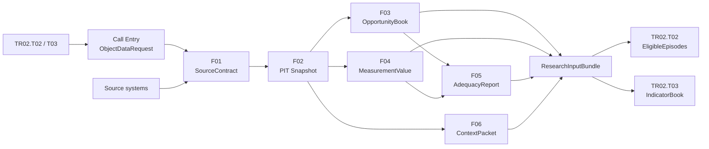

# Offline Research Public Chain：F01–F06 逐步示例

日期：2026-10-29  
示例对象：`TR02 — Liquidity Buffer Orientation`  
示例调用节点：`TR02.T02 Opportunity Construction`、`TR02.T03 Indicator Calculation`

> 本文使用模拟记录解释接口和数据流，不代表 EDF 4.0 已经跑出的真实研究结果。F01–F06 是建议的公共底座原子能力，不是另一个会自行产生 Trait/State/Signal 结论的 Agent。

---

## 1. 先用一句话讲清 Public Chain

Public Chain 是 Trait、State、Signal 共用的“受控数据实验室”：

```text
对象节点提出一个有边界的数据请求
→ Public Chain 绑定来源、生成 PIT 快照、构造机会、计算测量、检查充分性、隔离上下文
→ 返回有血缘的 ResearchInputBundle
→ 对象节点再用自己的语义规则形成 Trait/State/Signal 证据
```

它不是下面这种关系：

```text
F01 → F02 → F03 → F04 → F05 → F06 → 自动得出 TR02
```

正确关系是：

```text
TR02.T02/T03 是调用者
F01–F06 是被调用的公共能力
TR02.T02/T03 拿回公共结果后，继续完成对象语义判断
```

Public Chain 可以回答：

- 数据来自哪里？
- 在 `as_of` 时点，当时真正知道什么？
- 本来存在哪些可观察机会？
- 按冻结公式计算出的测量是多少？
- 数据是否足够支持后续研究？
- 这个 Worker 被允许看到什么背景和事实？

Public Chain 不回答：

- 客户是否“拥有 TR02”？
- TR02 percentile 是多少？
- 是否存在某个 Requirement？
- 是否应创建 Opportunity？
- 是否应向客户采取行动？

---

## 2. 本例到底要研究什么

TR02 的研究问题是：

> 在存在真实自主选择机会、控制临时用途和产品可得性以后，客户是否持续倾向保留流动性缓冲？

为了回答这个问题，`TR02.T02/T03` 需要公共链提供：

1. 账户、持仓、定存合同和已知义务的时点安全事实。
2. 所有可能构成“自主流动性选择”的候选机会。
3. Stable cash share、liquidity-buffer ratio、rollover persistence 的基础测量。
4. 覆盖、历史、episode、方法家族和独立参照是否充足。
5. 一个只包含 TR02 被授权内容的 ContextPacket。

本例使用：

```yaml
object_id: TR02
caller_nodes:
  - T02
  - T03
subject_id: C001
as_of: 2026-10-01T23:59:59+08:00
environment: sandbox
purpose: trait_research
```

---

## 3. 完整数据流



需要注意：F03、F04、F06 可以在 F02 以后并行；F01–F06 并不一定是严格的单线程串行任务。

---

## 4. Call Entry：对象节点先提出有边界的请求

### 4.1 为什么需要 Call Entry

TR02 Agent 不能说：

> 把 C001 的全部数据给我。

它必须根据 `TraitStudySpec` 生成一个最小、可审计的 `ObjectDataRequest`。

### 4.2 Input

```yaml
study_spec_id: TR02.study.v1
object_id: TR02
caller_nodes: [T02, T03]
as_of: 2026-10-01T23:59:59+08:00
requested_facts:
  - eligible_account_balance
  - eligible_asset_base
  - known_near_term_obligation
  - td_contract
  - td_maturity_decision
  - product_availability
requested_measurements:
  - stable_cash_share
  - liquidity_buffer_ratio
  - deposit_rollover_persistence
forbidden_inputs:
  - final_trait_assessments
  - final_state_assessments
  - final_signal_assessments
  - requirement_results
  - opportunity_results
```

### 4.3 人工预设

- 允许请求哪些来源和字段。
- 研究用途和适用主体。
- `as_of` 和时区口径。
- 禁止读取哪些其他分支结果。
- 最小化原则：只取完成 T02/T03 所需的内容。

### 4.4 LLM 可以做什么

- 根据 TraitStudySpec 起草请求。
- 检查是否遗漏必要字段。
- 解释某个字段为什么需要。
- 提醒请求可能过宽。

LLM 不能自行扩大授权范围。

### 4.5 Human Validation

Research Owner 和 Data Owner 检查：

- 请求是否与 TR02 研究目的匹配。
- 是否申请了不必要的数据。
- 是否包含跨分支结果泄漏。
- `as_of`、主体和用途是否正确。

### 4.6 Output

```yaml
request_id: req-tr02-c001-20261001-001
request_status: APPROVED_FOR_SANDBOX
object_id: TR02
caller_nodes: [T02, T03]
as_of: 2026-10-01T23:59:59+08:00
policy_version: context-policy-trait-v1
```

---

## 5. F01 Source Binding：把业务概念绑定到真实来源

### 5.1 F01 解决什么问题

TR02 需要“可用流动资产”和“定存到期决策”，但数据库里不会直接存在这两个完美字段。

F01 负责说明：

- 去哪张表取。
- 哪个字段代表什么。
- 主体、账户和合同怎样关联。
- 数据粒度是什么。
- 单位和币种是什么。
- 哪个来源是权威来源。
- 哪些字段是 `effective_at`，哪些是 `known_at`。

### 5.2 Input

```yaml
request_id: req-tr02-c001-20261001-001
source_catalog:
  - core_account_daily
  - security_position_daily
  - td_contract_master
  - td_maturity_action
  - product_availability_daily
  - known_obligation_register
```

### 5.3 本例来源映射

| TR02 所需事实 | 来源 | Grain | 主键 | 数值/状态字段 | 时间字段 |
|---|---|---|---|---|---|
| Account balance | `core_account_daily` | account-day | subject + account + date | closing_balance, currency | effective_at, known_at |
| Security position | `security_position_daily` | position-day | subject + position + date | market_value, liquidity_class | effective_at, known_at |
| TD contract | `td_contract_master` | contract-version | subject + contract + version | status, principal, due_at | effective_at, known_at |
| Maturity decision | `td_maturity_action` | contract-milestone | contract + milestone | action_type, retained_amount | action_at, known_at |
| Product availability | `product_availability_daily` | subject-product-day | subject + product + date | available_flag | effective_at, known_at |
| Known obligation | `known_obligation_register` | obligation-version | subject + obligation + version | amount, due_at, status | effective_at, known_at |

### 5.4 人工预设

- Subject、account、contract 的身份映射。
- 权威来源和冲突优先级。
- Grain、主键、单位和币种。
- 状态枚举含义。
- `effective_at` 与 `known_at` 的字段语义。

### 5.5 LLM 可以做什么

- 根据 schema 起草字段映射。
- 对比两个版本的 schema diff。
- 发现名称相似但语义可能不同的字段。
- 生成 adapter 测试用例。

LLM 不能自行宣布某张表为权威来源。

### 5.6 Human Validation

Data Owner 必须确认：

- `closing_balance` 是否真的代表日终余额。
- `known_at` 是进入平台的时间还是业务生效时间。
- 合同状态是否包含取消、冻结和提前终止。
- 币种转换使用哪个汇率和时间点。
- 账户、合同和主体的关联是否可能一对多。

### 5.7 Output：SourceContract

```yaml
source_contract_id: sc-tr02-v1
subject_key: client_id
base_currency: CNY
identity_mapping_version: identity-v4
sources:
  core_account_daily:
    authority: PRIMARY
    grain: account_day
    effective_time: business_date_end
    known_time: ingestion_committed_at
  td_contract_master:
    authority: PRIMARY_FOR_CONTRACT
    grain: contract_version
    effective_time: contract_effective_at
    known_time: source_known_at
```

F01 的 Output 仍然只是数据契约，不包含任何客户分数。

---

## 6. F02 PIT Snapshot：只保留 as_of 当时真正知道的事实

### 6.1 F02 解决什么问题

研究最常见的错误之一，是把后来才收到的修订信息放回过去，造成未来泄漏。

本例有两条针对同一余额日的记录：

| record_id | effective_at | known_at | stable_liquid_assets | 说明 |
|---|---|---|---:|---|
| BAL-v1 | 2026-09-30 | 2026-10-01 08:00 | 1,400,000 | 在 as_of 前已知 |
| BAL-v2 | 2026-09-30 | 2026-10-05 10:00 | 1,100,000 | 后来才到达的修订 |

当前请求：

```text
as_of = 2026-10-01 23:59:59 +08:00
```

因此：

- `BAL-v1` 可以进入快照。
- `BAL-v2` 虽然 effective_at 更早，但 known_at 晚于 as_of，不能进入这次快照。

### 6.2 Input

```yaml
source_contract_id: sc-tr02-v1
as_of: 2026-10-01T23:59:59+08:00
raw_record_count: 428
revision_record_count: 17
```

### 6.3 代码执行

```text
1. 按 SourceContract 校验主键、类型、单位和时间字段
2. 过滤 known_at > as_of 的记录
3. 对同一业务主键按冻结优先级去重
4. 保留 revision / supersedes 血缘
5. 生成 snapshot hash
```

### 6.4 人工预设

- PIT 截止规则。
- 时区。
- 去重优先级。
- 迟到数据和修订政策。
- 什么情况下重算历史结果。
- supersedes 如何记录。

### 6.5 LLM 可以做什么

- 总结被排除的记录和原因。
- 归纳异常修订模式。
- 生成泄漏测试建议。

逐行过滤和去重必须由确定性代码执行，不能由 LLM 判断。

### 6.6 Human Validation

- 抽样检查未来记录是否被排除。
- 用历史回放验证同一 as_of 能否得到同一快照。
- 检查修订是否保留了旧版本。
- 检查时区边界和日终切换。

### 6.7 Output

```yaml
snapshot_id: snap-tr02-c001-20261001-001
as_of: 2026-10-01T23:59:59+08:00
input_records: 428
future_known_records_excluded: 12
duplicate_records_resolved: 5
typed_fact_count: 411
snapshot_hash: sha256:example-snapshot-hash
selected_balance_record: BAL-v1
excluded_revision: BAL-v2
```

---

## 7. F03 Opportunity Book：建立完整候选分母

### 7.1 F03 解决什么问题

不能只观察客户“做了什么”，还要知道客户“什么时候本来有机会做出选择”。

F03 枚举候选机会，但不替 TR02 做最终 Eligibility 判断。

### 7.2 Input

- F02 的 PIT TypedFacts。
- 定存到期事实。
- 当时的产品可得性。
- 行为是否自动或强制。
- 结果是否完整。
- 通用 OpportunitySpec。

### 7.3 本例的九条候选机会

| opportunity_id | 日期 | 候选事件 | 产品可得 | 自主/强制 | 结果完整 | F03 observation status |
|---|---|---|---|---|---|---|
| O01 | 2026-04-08 | TD 到期后配置 | Yes | Voluntary | Yes | OBSERVABLE |
| O02 | 2026-05-03 | TD 到期后配置 | Yes | Voluntary | Yes | OBSERVABLE |
| O03 | 2026-05-28 | 资金重新配置 | Yes | Voluntary | Yes | OBSERVABLE |
| O04 | 2026-06-21 | TD 到期后配置 | Yes | Voluntary | Yes | OBSERVABLE |
| O05 | 2026-07-17 | TD 到期后配置 | Yes | Voluntary | Yes | OBSERVABLE |
| O06 | 2026-09-10 | TD 到期后配置 | Yes | Voluntary | Yes | OBSERVABLE |
| O07 | 2026-08-02 | TD 自动续存 | Yes | Forced | Yes | FORCED |
| O08 | 2026-08-25 | 资金重新配置 | No | Voluntary | Yes | NO_OPPORTUNITY |
| O09 | 2026-09-25 | TD 到期后配置 | Yes | Voluntary | No | SOURCE_MISSING |

F03 不删除 O07–O09。它们必须留在 OpportunityBook 中，才能解释分母是怎样形成的。

### 7.4 人工预设

- 什么是候选 opportunity。
- Stable opportunity ID 的组成。
- 产品/渠道可得性的定义。
- `OBSERVABLE / FORCED / NO_OPPORTUNITY / SOURCE_MISSING` reason code。
- 重复 opportunity 的处理。

### 7.5 LLM 可以做什么

- 从 bad case 中提出新的 reason code。
- 帮助起草 OpportunitySpec。
- 总结为什么某类机会经常不可观察。

LLM 不参与逐条枚举和最终分母计算。

### 7.6 Human Validation

- 抽样确认 OpportunityBook 是否漏掉真实机会。
- 检查强制行为是否被错误标成自主行为。
- 检查产品可得性是否使用当时而不是现在的信息。
- 审核 reason code 是否互斥、完整和可解释。

### 7.7 Output

```yaml
opportunity_book_id: opp-tr02-c001-20261001-001
candidate_count: 9
status_counts:
  OBSERVABLE: 6
  FORCED: 1
  NO_OPPORTUNITY: 1
  SOURCE_MISSING: 1
```

注意：这里还没有输出 `TR02 EligibleEpisodes`。那是后面的 `TR02.T02` 使用 TR02 语义产生的对象结果。

---

## 8. F04 Measurement：按冻结公式生成可追溯测量

### 8.1 F04 解决什么问题

F04 把 PIT TypedFacts 和 OpportunityBook 转换成有类型、有单位、有分子分母、有来源血缘的 MeasurementValue。

本例计算三个候选测量。

### 8.2 本例的冻结测量定义

#### Measurement A：Stable cash share

```text
stable_cash_share
= stable_liquid_assets / eligible_asset_base
= 1,400,000 / 2,000,000
= 0.70
```

#### Measurement B：Liquidity-buffer ratio

```text
liquidity_buffer_ratio
= stable_liquid_assets / known_near_term_obligations
= 1,400,000 / 437,500
= 3.20x
```

#### Measurement C：Deposit rollover persistence

F03 提供 9 条候选机会，但当前公式只使用 6 条 `OBSERVABLE` 决策：

```text
retained_liquidity_decisions = 5
observable_maturity_decisions = 6

deposit_rollover_persistence
= 5 / 6
= 0.8333
```

O07–O09 不能被补成 0：

- `FORCED` 不是客户自主选择。
- `NO_OPPORTUNITY` 没有真实选择条件。
- `SOURCE_MISSING` 不知道发生了什么。

### 8.3 Input

```yaml
snapshot_id: snap-tr02-c001-20261001-001
opportunity_book_id: opp-tr02-c001-20261001-001
measurement_definitions:
  - stable_cash_share.v1
  - liquidity_buffer_ratio.v1
  - deposit_rollover_persistence.v1
```

### 8.4 人工预设

- 公式和 AST。
- 分子与分母语义。
- 单位和方向。
- Window 和 lookback。
- 零分母政策。
- Missing reason。
- 允许使用哪些 Opportunity status。
- 币种转换和来源贡献规则。

### 8.5 LLM 可以做什么

- 起草公式候选。
- 检查自然语言定义与公式是否一致。
- 生成边界测试和零分母测试。
- 解释某个 MeasurementValue 的来源。

生产数值必须由冻结代码执行，不能由 LLM 估算。

### 8.6 Human Validation

- 审核公式业务含义。
- 检查单位和方向。
- 验证零分母没有被填成 0。
- 核对来源贡献能否追溯到具体事实。
- 审核公式版本和单元测试。

### 8.7 Output

```yaml
measurement_set_id: ms-tr02-c001-20261001-001
values:
  - measurement_id: stable_cash_share.v1
    value: 0.70
    numerator: 1400000
    denominator: 2000000
    unit: ratio
    coverage: COMPLETE
  - measurement_id: liquidity_buffer_ratio.v1
    value: 3.20
    numerator: 1400000
    denominator: 437500
    unit: x
    coverage: COMPLETE
  - measurement_id: deposit_rollover_persistence.v1
    value: 0.8333
    numerator: 5
    denominator: 6
    unit: ratio
    coverage: COMPLETE
```

F04 仍然没有计算 TR02 percentile。Raw score、comparable domain 和 percentile transform 属于后面的 Trait 对象链。

---

## 9. F05 Adequacy：判断数据是否足够进入后续研究

### 9.1 F05 解决什么问题

测量可以算出来，不等于证据已经足够。

F05 检查：

- 历史是否足够。
- Distinct episodes 是否足够。
- 是否有至少两个独立方法家族。
- 前后窗口是否都有覆盖。
- 研究分区是否可行。
- 独立参照是否存在。

### 9.2 本例的预设门槛

```yaml
minimum_history_days: 90
minimum_distinct_episodes: 6
minimum_method_families: 2
require_split_half: true
minimum_complete_episodes_per_half: 3
require_independent_construct_reference_for_T08: true
```

### 9.3 本例检查结果

| 检查项 | 观察值 | 门槛 | 结果 |
|---|---:|---:|---|
| Evidence span | 155 days | >= 90 | PASS |
| Distinct observable episodes | 6 | >= 6 | PASS |
| Independent method families | 2 | >= 2 | PASS |
| First-half complete episodes | 3 | >= 3 | PASS |
| Second-half complete episodes | 3 | >= 3 | PASS |
| Independent construct reference | Missing | Required for T08 | FAIL / DEFER |

因此本例可以：

- 进入 T02/T03/T05/T06/T07 的研究计算。

但不能：

- 宣称 T08 构念验证已经完成。
- 发布 Production Trait。

### 9.4 人工预设

- Minimum history。
- Minimum episode。
- Minimum method family。
- Split 要求。
- 独立参照要求。
- PASS、INSUFFICIENT、DEFER 的规则。

### 9.5 LLM 可以做什么

- 总结 Adequacy 缺口。
- 解释为什么某个检查失败。
- 建议补充数据或独立参照。
- 为 reviewer 生成摘要。

LLM 不能为了让研究通过而放宽门槛。

### 9.6 Human Validation

- 研究负责人审核门槛是否在看结果前预注册。
- 检查是否存在事后调整标准。
- 审核 override 是否有正式理由。
- 确认独立参照确实独立。

### 9.7 Output

```yaml
adequacy_report_id: adequate-tr02-c001-20261001-001
measurement_status: SUFFICIENT
persistence_research_status: SUFFICIENT
construct_validation_status: INSUFFICIENT_REFERENCE
overall_recommendation: DEFER_PRODUCTION_VALIDATION
blocking_reasons:
  - NO_INDEPENDENT_CONSTRUCT_REFERENCE
```

---

## 10. F06 Context Packet：控制这个 Worker 能看到什么

### 10.1 F06 解决什么问题

如果 Trait Agent 能读取 State/Signal 的最终结论，它可能把其他分支结论当作自己的证据，造成上下文污染和循环推理。

F06 按对象、Worker role 和节点生成最小 ContextPacket。

### 10.2 本例 Context Policy

```yaml
policy_id: context-policy-trait-v1
worker_role: trait_research_worker
object_id: TR02
allow:
  - public_client_background
  - PIT_typed_financial_facts
  - product_availability_facts
  - known_obligation_facts
  - TR02_StudySpec
  - TR02_OpportunityBook
  - TR02_MeasurementValues
deny:
  - final_trait_assessments_from_other_traits
  - final_state_assessments
  - final_signal_assessments
  - requirement_results
  - opportunity_results
  - future_known_records
```

### 10.3 实际返回内容

允许：

- 客户类型和必要公共背景。
- PIT 安全的余额、持仓、合同、产品可得性和已知义务。
- TR02 自己的 StudySpec、OpportunityBook 和 MeasurementValue。

不允许：

- `ST01 = TRUE`。
- `SG01 = TRUE`。
- `R01 = TRUE`。
- 某个下游产品推荐结果。
- 未来才知道的合同修订。

### 10.4 人工预设

- Role-based allowlist 和 denylist。
- 哪些背景是公共背景。
- 哪些分支结果必须隔离。
- 数据敏感级别和脱敏。
- Context 版本、审计和过期。

### 10.5 LLM 可以做什么

- 只消费 ContextPacket 内已经授权的内容。
- 在授权事实内归纳和生成研究摘要。
- 提醒 Context 中缺少完成任务的必要字段。

LLM 不能自行调用未授权数据源，也不能扩大 ContextPolicy。

### 10.6 Human Validation

- Security Owner 和 Research Owner 审核 policy。
- 运行越权测试。
- 检查 Prompt 和工具是否可能间接读取 denied outputs。
- 检查 ContextManifest 是否完整记录实际可见内容。

### 10.7 Output

```yaml
context_manifest_id: ctx-tr02-c001-20261001-001
policy_id: context-policy-trait-v1
allowed_artifacts:
  - snap-tr02-c001-20261001-001
  - opp-tr02-c001-20261001-001
  - ms-tr02-c001-20261001-001
denied_categories:
  - STATE_FINAL_OUTPUT
  - SIGNAL_FINAL_OUTPUT
  - REQUIREMENT_OUTPUT
  - FUTURE_KNOWN_RECORD
manifest_hash: sha256:example-context-hash
```

---

## 11. Return Bundle：公共链怎样把结果交回 TR02

### 11.1 Input

- F01 `SourceContract`
- F02 `SnapshotManifest + TypedFacts`
- F03 `OpportunityBook`
- F04 `MeasurementValueSet`
- F05 `AdequacyReport`
- F06 `ContextManifest + ContextPacket`

### 11.2 Bundle

```yaml
bundle_id: bundle-tr02-c001-20261001-001
request_id: req-tr02-c001-20261001-001
object_id: TR02
caller_nodes: [T02, T03]
as_of: 2026-10-01T23:59:59+08:00
artifacts:
  source_contract: sc-tr02-v1
  snapshot: snap-tr02-c001-20261001-001
  opportunity_book: opp-tr02-c001-20261001-001
  measurements: ms-tr02-c001-20261001-001
  adequacy: adequate-tr02-c001-20261001-001
  context_manifest: ctx-tr02-c001-20261001-001
status:
  measurement: SUFFICIENT
  construct_validation: INSUFFICIENT_REFERENCE
bundle_hash: sha256:example-bundle-hash
```

### 11.3 人工预设

- Bundle schema。
- 哪些 artifact 是必需的。
- 版本和 hash 规则。
- Error / partial / unavailable 状态。
- 下游哪个节点能消费哪些字段。

### 11.4 LLM 可以做什么

- 生成 Bundle 摘要。
- 聚类 missing reason 和异常。
- 解释为什么某个下游节点被阻塞。

### 11.5 Human Validation

- 审核异常和 partial bundle。
- 检查 bundle 是否违反最小权限。
- 确认所有 artifact 能追溯到同一个 request/as_of。

Public Chain 到这里结束。它没有输出 Trait 分数或 Trait 结论。

---

## 12. Bundle 返回以后，T02 和 T03 分别做什么

### 12.1 TR02.T02：从通用 OpportunityBook 生成 EligibleEpisodes

T02 应用 TR02 的对象语义：

```text
O01–O06 = OBSERVABLE + VOLUNTARY + PRODUCT_AVAILABLE + OUTCOME_COMPLETE
→ Eligible

O07 = FORCED
→ Excluded: FORCED_BEHAVIOUR

O08 = NO_OPPORTUNITY
→ Excluded: PRODUCT_NOT_AVAILABLE

O09 = SOURCE_MISSING
→ Excluded: OUTCOME_MISSING
```

T02 Output：

```yaml
eligible_episode_set_id: eligible-tr02-c001-20261001-001
candidate_count: 9
eligible_count: 6
excluded:
  FORCED_BEHAVIOUR: 1
  PRODUCT_NOT_AVAILABLE: 1
  OUTCOME_MISSING: 1
```

为什么不让 F03 直接输出这个结果？

因为 F03 是通用公共能力，而“什么能够作为 TR02 证据”属于 TR02 对象语义。换成另一个 Trait，同一条 Opportunity 可能会有不同的 Eligibility。

### 12.2 TR02.T03：从通用 MeasurementValue 生成 IndicatorBook

T03 应用 TR02 的指标家族设计：

```yaml
indicator_book_id: indicators-tr02-c001-20261001-001
families:
  balance_structure:
    - stable_cash_share: 0.70
    - liquidity_buffer_ratio: 3.20
  maturity_decision:
    - deposit_rollover_persistence: 0.8333
adequacy:
  method_family_count: 2
  measurement_status: SUFFICIENT
```

T03 只把公共 MeasurementValue 组织成 TR02 的 IndicatorBook。后面的：

- T04 Rival reconciliation
- T05 Raw score
- T06 Percentile
- T07 Persistence
- T08 Construct validation

仍由 Trait 对象链继续完成。

---

## 13. 从头到尾的一行数据传输总结

```text
TR02 StudySpec
→ ObjectDataRequest
→ SourceContract
→ PIT Snapshot / TypedFacts
→ OpportunityBook + MeasurementValue
→ AdequacyReport + ContextPacket
→ TR02 ResearchInputBundle
→ T02 EligibleEpisodes + T03 IndicatorBook
→ T04–T08 后续研究
```

对应本例：

```text
TR02 请求流动性相关最小事实
→ F01 绑定六类来源
→ F02 排除 10 月 5 日才知道的历史修订
→ F03 枚举 9 次候选机会并保留 3 个不可用原因
→ F04 计算 0.70、3.20x、5/6 三项测量
→ F05 判断测量足够，但缺少独立构念参照
→ F06 隔离 State/Signal/Requirement 最终结果
→ Bundle 返回 T02/T03
→ T02 得到 6 个 EligibleEpisodes
→ T03 得到两个方法家族的 IndicatorBook
→ 仍然不能宣称 TR02 已验证或可生产发布
```

---

## 14. Public Chain 页面应该怎样展示这个例子

建议 Public Chain 页面至少有四个区域。

### 14.1 Caller

显示：

- 谁在调用：`TR02.T02/T03`
- 为什么调用：Trait research
- Request ID
- as_of
- Data policy
- Config version

### 14.2 Step Timeline

```text
Call Entry
→ F01 Source Binding
→ F02 PIT Snapshot
→ F03 Opportunity Book
→ F04 Measurement
→ F05 Adequacy
→ F06 Context Packet
→ Return Bundle
```

点击每个步骤显示：

- Input
- 人工预设
- LLM Assist
- 确定性代码动作
- Human Validation
- Output
- Artifact ID
- Version/hash
- 示例记录

### 14.3 Data Trace

用户应能点击：

```text
IndicatorValue 0.70
→ numerator 1,400,000
→ denominator 2,000,000
→ PIT TypedFacts
→ Source rows
→ SourceContract
```

也应能点击：

```text
O07 excluded
→ F03 status = FORCED
→ source action = AUTO_RENEWAL
→ T02 reason = FORCED_BEHAVIOUR
```

### 14.4 Return Bundle

显示：

- 哪些 artifact 已生成。
- 哪些检查通过。
- 哪些内容不足。
- 哪些对象节点可以继续运行。
- 哪些节点被阻塞。

本例页面应明确显示：

```text
T02/T03/T05/T06/T07：可继续研究
T08：Blocked — independent construct reference missing
Production release：Not allowed
```

---

## 15. 谁修改什么

| 内容 | 人工预设 | LLM Assist | 代码执行 | Human Validation |
|---|---|---|---|---|
| ObjectDataRequest | 用途、范围、权限 | 起草请求、查缺口 | Schema 校验 | Owner 审核最小化和授权 |
| F01 SourceContract | 来源权威、字段语义、grain、单位 | Schema mapping 建议 | Adapter 执行 | Data Owner 签字 |
| F02 PIT | 时间、去重、修订政策 | 异常日志总结 | 逐行过滤和快照 | 泄漏测试、历史回放 |
| F03 Opportunity | 机会定义、reason code | 从 bad case 提议候选 | 枚举、标记、去重 | 分母语义抽检 |
| F04 Measurement | 公式、单位、方向、缺失 | 公式草案、测试生成 | 数值计算 | 公式和血缘验证 |
| F05 Adequacy | 门槛、split、参照要求 | 缺口摘要 | 自动检查 | 审核门槛和 override |
| F06 Context | allowlist、denylist、权限 | 授权内容内总结 | Policy enforcement | 越权测试和审计 |
| Return Bundle | Schema、版本、错误状态 | 异常摘要 | 组装和 hash | Partial bundle 审核 |

原则：

> LLM 帮助设计、解释和发现问题；确定性代码处理逐记录计算；人工决定语义、权限、门槛和是否接受证据。

---

## 16. 最容易混淆的五件事

### 16.1 F03 OpportunityBook 不等于 T02 EligibleEpisodes

F03 给出通用候选机会和可观察状态；T02 用 TR02 语义决定哪些可以作为 TR02 分母。

### 16.2 F04 MeasurementValue 不等于 Trait Indicator 结论

F04 只按公式计算事实测量；T03 才把它组织为 TR02 IndicatorBook；T04–T08 继续做归因、稳定性和构念验证。

### 16.3 F05 PASS 不等于对象已经验证

F05 只说明某类数据和研究条件是否充分。TR02 是否成立仍需要 T08 Construct Validation 和 T09 人工发布决策。

### 16.4 F06 给背景不等于允许跨分支偷看结果

公共背景可以共享，其他 Trait/State/Signal 的最终结论必须按 policy 隔离。

### 16.5 Public Chain 是共享能力，不是共享大宽表

每次调用都必须携带：

- Object ID
- Caller node
- Purpose
- as_of
- Requested fields
- Context policy
- Version

因此 TR02、ST01、SG01 虽然共用 F01–F06，但得到的是不同的、有边界的 ResearchInputBundle。

---

## 17. MVP 最小实现建议

冷启动时不需要先构建一个复杂公共平台。可以先实现：

```text
public_chain/
├── source_binding.py
├── pit_snapshot.py
├── opportunity_book.py
├── measurement.py
├── adequacy.py
├── context_packet.py
└── bundle.py
```

配合：

```text
configs/
├── source_contracts/
├── opportunity_specs/
├── measurement_definitions/
├── adequacy_policies/
└── context_policies/
```

第一版 Public Chain 页面只需要支持：

1. 选择一次对象调用。
2. 查看 Call Entry 和 F01–F06 状态。
3. 查看每步 Input/Output 示例。
4. 修改 Draft 配置。
5. 调用 LLM 生成配置建议。
6. 查看 Diff。
7. 运行 Sandbox。
8. 查看 Bundle 和 Trace。
9. 将异常送入 Human Review。

不需要一开始实现拖拽 DAG、动态插件市场或所有对象的完整配置。

